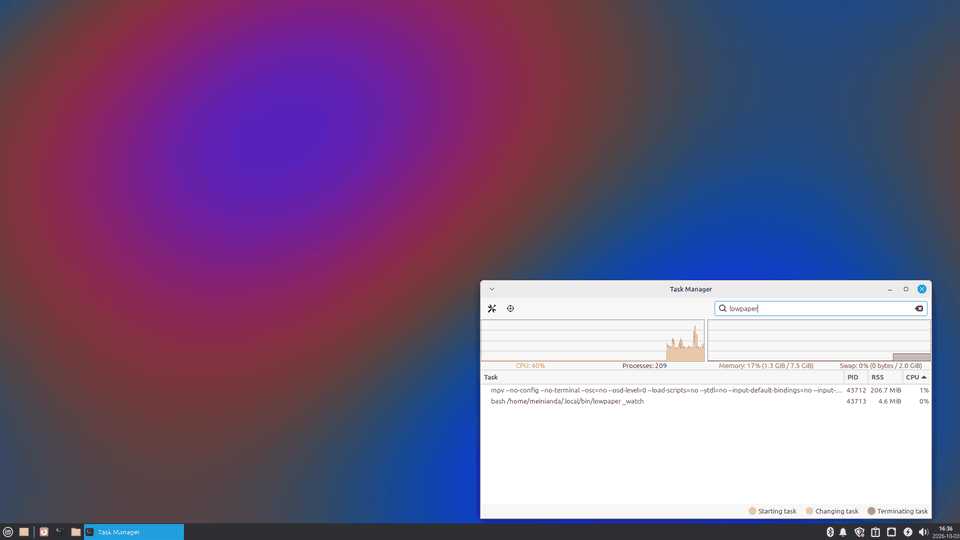

<p align="center">
  
</p>

<h1 align="center">lowpaper</h1>

<p align="center">
  Ultra-lightweight, low-resource video wallpaper for Linux, designed for low-end and old hardware.<br>
  A minimal Bash script around mpv, with automatic pausing when the wallpaper is not visible.
</p>

<p align="center">
  <a href="#install">Install</a> &nbsp;·&nbsp;
  <a href="#usage">Usage</a> &nbsp;·&nbsp;
  <a href="#requirements">Requirements</a> &nbsp;·&nbsp;
  <a href="#how-it-works">How it works</a> &nbsp;·&nbsp;
  <a href="#measured">Measured</a>
</p>

<p align="center">
  
</p>

## Features

- **Lightweight, low resource.** About 2% of one CPU core while playing, 0% when covered. See [Measured](#measured).
- **Runs on low-end, old hardware.** Tested on a Core2 Duo with no hardware video decoding.
- **Minimal.** One Bash script. No daemon, no GUI, no Electron.
- **Built on mpv.** A mature, light player does the decoding; lowpaper only places it and pauses it.
- **Video wallpaper, image or slideshow.** mp4, webm, gif, jpg, png, or a whole folder.
- **X11 and Wayland.** XFCE, MATE, Cinnamon, Sway, Hyprland, KDE.
- **Pauses itself** when a fullscreen or maximized window covers the desktop.

## Install

```sh
sudo apt install mpv
git clone https://github.com/Meinianda-L/lowpaper-live-wallpaper.git
install -Dm755 lowpaper-live-wallpaper/lowpaper ~/.local/bin/lowpaper
```

## Usage

```sh
lowpaper ~/Videos/rain.mp4
lowpaper ~/Pictures/sky.jpg
lowpaper -i 600 -s ~/Pictures     # folder = slideshow; -i image interval in seconds, -s shuffle
lowpaper -f fit video.mp4         # fill (default, crop) | fit (letterbox) | stretch
lowpaper -o HDMI-1 video.mp4      # one monitor only
lowpaper                          # show what is playing
lowpaper pause | resume | toggle | next | stop | status | restore
lowpaper fit fill|fit|stretch     # change scaling live
lowpaper autopause on|off         # pause while the wallpaper is covered (default on)
lowpaper startup on|off           # start at login, restoring the last wallpaper
```

Settings live in `~/.config/lowpaper/config` (`FIT`, `INTERVAL`, `AUTOPAUSE`, `CACHE_MB`, `ICONS`, `HWDEC`).

## Requirements

| Environment | Needs |
|---|---|
| all | mpv |
| X11 desktop with a desktop window (XFCE, MATE, Cinnamon, ...) | python3, xprop, xrandr, xkill (preinstalled on Debian, Ubuntu, Mint) |
| Wayland with layer-shell (Sway, Hyprland, KDE, ...) | gcc, used once to build a 30 KB helper |

Optional: `gcc` also keeps XFCE desktop icons above the video. OpenBSD `nc` (default on Debian and Ubuntu) is used for mpv IPC, about 3 ms per call; without it lowpaper falls back to python, which is much slower on old CPUs.

GNOME on Wayland has no layer-shell; use the Hanabi extension there. Bare window managers (i3, openbox) without a desktop window are not supported.

## How it works

**X11.** A one-shot python call creates a desktop-type window and exits. mpv draws into it with `--wid`, using Xv where available, which is the cheapest path on old GPUs. A small Bash watcher follows focus and window-state changes through `xprop -spy`, so it sleeps until something actually changes, and pauses mpv while a fullscreen or maximized window is on top or the monitor is off.

**Wayland.** lowpaper builds a small C helper the first time it is needed and keeps it in `~/.cache/lowpaper`. The helper speaks the wlr-layer-shell protocol directly, places one background surface per output, and renders through libmpv. It declares the few Wayland, EGL and libmpv functions it uses itself, so no `-dev` packages are needed: only gcc and the libraries mpv already depends on. A compositor stops sending frame callbacks to a surface nobody can see; the helper uses that to pause.

**Short clips** are decoded once and replayed from RAM, which takes the decoder out of the loop. Longer videos fall back to normal decoding. `CACHE_MB` sets the limit.

## Measured

Linux Mint 22.3 XFCE/X11, Core2 Duo P8600, GeForce 320M (nouveau, no usable hwdec), 1080p display, 1280×962 10 fps H.264 clip (3 s).

| | CPU (% of one core) | RAM |
|---|---|---|
| playing: mpv (short clip, decoded once and replayed from RAM) | 2.1% | 138 MB |
| playing: mpv (decoding every loop, `CACHE_MB=0`) | 13.9% | 94 MB |
| playing: Xorg + xfwm4 compositor, icons above the video | 12–14% | |
| watcher (bash + 2 × xprop) | ~0% | 8 MB |
| covered by a fullscreen or maximized window | 0% | same |
| single image on XFCE | 0 | 0 |
| single image through mpv (`--mpv` or slideshow) | 0 | ~200 MB |

## Known limits

- After a resolution or monitor change, or if xfdesktop restarts on its own, run `lowpaper restore`.
- On Wayland, `lowpaper autopause on|off` applies from the next start.
